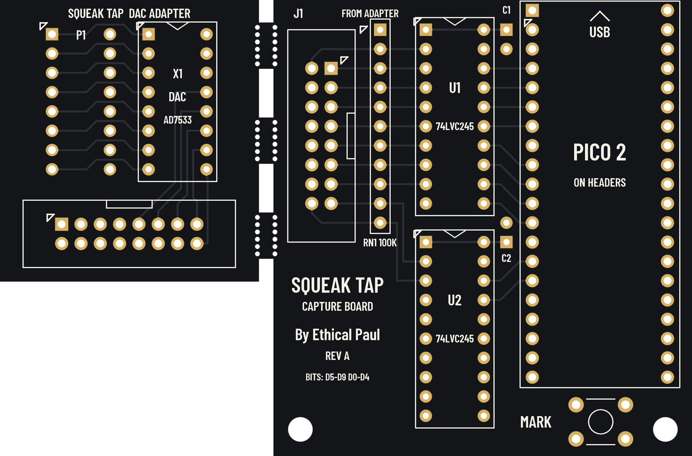

# Squeak Tap Rev A: board files

Two boards on one 91 × 60 mm panel, separated by a 2 mm routed gap and held by three mouse-bite tabs laid out to JLCPCB's mouse-bite guide. Order the panel, snap the tabs, sand the nubs. By Ethical Paul.

| Board | Size | What it does |
| --- | --- | --- |
| 1, DAC adapter | 34 × 37 mm | Plugs into the CSD's DAC socket (U10). The original AD7533 sits in X1, 12.7 mm to the side, and still drives the CSD's audio. The 10 data bits and ground go to J2. |
| 2, capture board | 55 × 60 mm | Two 74LVC245 buffers (5 V in, 3.3 V out), a 100 k pull-down network and a Pico 2 that samples the bits at 960 kHz and streams them over USB. MARK button on GP12. |

## Files

| Path | What it is |
| --- | --- |
| `out/SqueakTap_RevA_Gerbers.zip` | Gerbers + Excellon (PTH and NPTH), the file to upload |
| `out/Schematic_RevA.pdf` | Schematic, two A3 sheets, drawn from the board netlist |
| `out/BOM.csv` | Bill of materials |
| `out/Ribbon_Pin_Map.csv` | Every ribbon pin: signal, CSD source, buffer input, Pico GPIO |
| `out/KiCad/SqueakTap.kicad_pcb` | KiCad 8 PCB: copper, drills, outline, nets, GND zone (refill it after opening; silkscreen lives in the Gerbers) |
| `make_panel.py` | Generates the Gerbers, drills and KiCad file |
| `make_docs.py` | Generates the schematic, BOM and pin map from the KiCad netlist |
| `tools/` | Squeak Check's Gerber reader, DRC and renderer, set for this panel |

Regenerate with `python3 make_panel.py && python3 make_docs.py`, then check with `python3 tools/drc.py out/Gerbers out/KiCad/SqueakTap.kicad_pcb 40`.

## Ordering

Upload `SqueakTap_RevA_Gerbers.zip` to any 2-layer fab: FR-4, 1.6 mm, 1 oz, HASL or ENIG, any mask colour, white silk.

- Tell the fab the file is a **panel you made yourself, with 2 different designs separated by a perforated (mouse-bite) line**: on the order page after uploading, set "Different Design" to 2 and "Delivery Format" to "Panel by Customer" (JLCPCB's names; other fabs have equivalents). Some fabs add a small charge for 2 designs.
- Layout follows JLCPCB's mouse-bite guide: a 2.0 mm routed gap (they recommend 1.6–2 mm), three 6 mm tabs, and on each tab a row of six non-plated 0.6 mm holes along each board's edge, 0.96 mm apart (0.36 mm webs; they recommend 0.35–0.4 mm and 5–8 holes per set). Hole centres sit 0.15 mm inside each board so the snapped nubs stay within the outline.
- To separate: hold Board 2 flat and bend Board 1 down; the three tabs break along the holes. Sand the nubs flush. Copper stays at least 1 mm back from the gap on both boards.

## Assembly notes

- **Board 1:** fit X1 (socket) on the top. Fit the two P1 pin strips from the **bottom**, thin ends down, and solder them from the top. Pin 1 is the square pad on both, marked with a triangle. The AD7533 goes into X1 with its notch matching the silk notch.
- **Board 2:** fit the Pico on female headers, not flat: C1 and C2 sit under its edge. RN1's pin 1 (common, dot on the part) goes to the square pad at the top. Box headers J1/J2 go with their key slots toward the silk key marks.
- **Ribbon:** a straight 16-way IDC cable, both sockets crimped the same way round, so pin 1 meets pin 1.
- **Fitting to the CSD:** power off, lift the AD7533 out of U10, plug Board 1's P1 in with pin 1 matching the CSD's U10 pin 1, then put the AD7533 into X1. Fitted backwards, P1 would put +12 V on a data line.

## Design checks (Rev A)

- Netlist: every pad's net matches the copper (F and B joined at plated holes): no shorts, no opens, no copper islands.
- Clearance between nets: 0.31 mm minimum on top, 0.28 mm on the bottom. Signal traces 0.25 mm, 3V3 0.3 mm, Board 1 ground 0.5 mm.
- Silkscreen clear of every mask opening on both sides.
- AD7533 pinout on Board 1 checked against the A080-91671 schematic: BIT1–BIT8 from PIA PA7–PA0, BIT9 from PB7, BIT10 from PB6, VDD +12 V on pin 14 (passed through only).
- Ribbon bit order is D5–D9 then D0–D4 so neither board's traces cross; the firmware rotates it back, and that rotation is checked against the board netlist.
- Not yet built: the panel hasn't been fabricated or fitted to a CSD.
